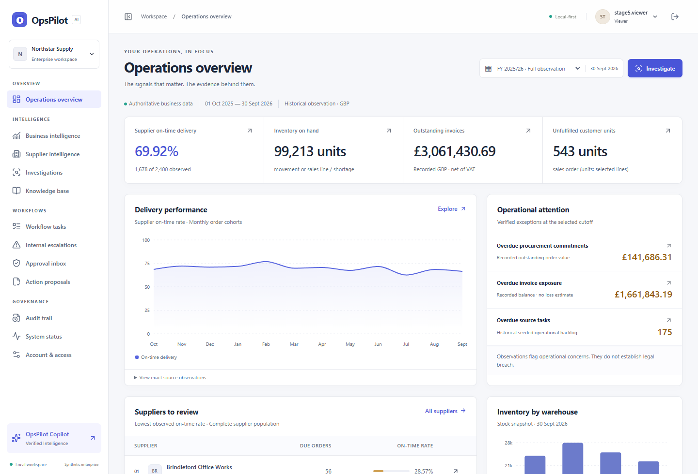

# OpsPilot AI

**Enterprise Operations Intelligence & AI Agent Platform**

OpsPilot turns fragmented operational records into source-backed decisions. It brings SQL analytics, supplier agreements and internal procedures into one workspace. When an investigation calls for action, an operator proposes a specific change and a separate reviewer approves it before execution.



[Quick start](docs/QUICK_START.md) · [Live demo guide](docs/DEMO_GUIDE.md) · [Screenshot gallery](assets/screenshots/README.md) · [Architecture](docs/ARCHITECTURE.md) · [Evaluation](docs/STAGE8_REPORT.md)

## A decision you can trace

Northstar Supply is a synthetic B2B distributor with 36 suppliers, 200 products and four warehouses. Its 2,400 purchase orders, 1,800 sales orders and 44 registered documents support investigations across procurement, fulfilment, stock, finance and workforce. Historical reporting spans October 2025 through September 2026. Current workflow activity is shown separately.

| From | To |
|---|---|
| A missed supplier target | Compare recorded receipts with original promises, denominators and the supplier’s own agreement. |
| A question about escalation | Retrieve the applicable policy and open its verified citation, source version and excerpt. |
| A proposed internal response | Submit the exact task or escalation for independent human review. |
| An approved action | Execute the versioned change in PostgreSQL, then inspect its receipt and audit events. |

## Try it locally

On Windows, install [Docker Desktop](https://docs.docker.com/desktop/setup/install/windows-install/) with Compose and [uv](https://docs.astral.sh/uv/getting-started/installation/). Open PowerShell in a fresh checkout and run:

```powershell
./scripts/opspilot.ps1 Setup -Open
```

Setup installs locked dependencies, fetches a pinned CPU embedding model, initializes PostgreSQL and generates private demo credentials. It refuses a checkout or Docker project with existing data. For an existing installation use `./scripts/opspilot.ps1 Start -Open`. The default browser address is [127.0.0.1:3106](http://127.0.0.1:3106).

Open `.local-tools/stage5-demo/accounts.json` locally. In the **Username** field, use `stage5.operator` to submit and execute or `stage5.reviewer` to approve. Each account has a separately generated password. [Setup and recovery](docs/QUICK_START.md)

**Try this investigation:** “Compare Supplier 1 delivery performance against its contractual SLA and escalation policy.” The accepted full-period data records 24 on-time receipts out of 72 due orders (33.33%) versus a 95% SLA. The answer cites the agreement and procedure. Use **Prepare internal review task** to turn the finding into a governed proposal. [Five-minute demo](docs/DEMO_GUIDE.md)

## How it works

- **Next.js / React / TypeScript** present the workspace. The server gateway handles the browser session, checks role and request boundaries, and forwards a small set of typed API calls.
- **FastAPI / PostgreSQL / Alembic** provide authoritative analytics and transactions. Read tools use restricted roles. An execution rechecks approval, evidence and state inside the workflow transaction.
- **pgvector / MiniLM ONNX** combine keyword and vector retrieval. Citations resolve to registered passages and verified source versions.
- **Deterministic intelligence** resolves business intent and entities, selects allowlisted tools and composes findings from verified evidence. It works without an API key or model inference. Local Qwen/Ollama language interpretation and the legacy agent remain experimental.

See the two paths side by side in the [architecture diagrams](docs/ARCHITECTURE.md). Read the [technical case study](docs/CASE_STUDY.md) for the design decisions, the limits of the evidence and the transaction tests.

## Quality evidence

The release checks cover PostgreSQL integration, browser navigation and approval, transaction faults, safe execution replay, scoped outage recovery, retrieval quality and business fingerprint preservation. See the [Stage 8 report](docs/STAGE8_REPORT.md) for current measurements and the distinction between local and hosted CI.

| Path | Purpose |
|---|---|
| `backend/` | FastAPI, domain services, migrations and real PostgreSQL tests |
| `frontend/` | Next.js workspace, gateway, contract and browser tests |
| `data/` and `knowledge/` | Synthetic data generator, evaluation fixtures and registered source documents |
| `scripts/` | Windows launcher, controlled maintenance and release checks |
| `docs/` and `reports/` | Engineering notes, test evidence and release decisions |

OpsPilot is a local portfolio demonstration with synthetic records and loopback services. The security review covers this scope. Deployment to a shared production environment would require a separate identity, TLS, data-retention and operational review. [Security model](docs/SECURITY_AUDIT.md) · [Release notes](docs/RELEASE_NOTES.md)

Created by [kirillprisaznuk-afk](https://github.com/kirillprisaznuk-afk) as a Business and Artificial Intelligence portfolio project. A project source license has not been selected.
