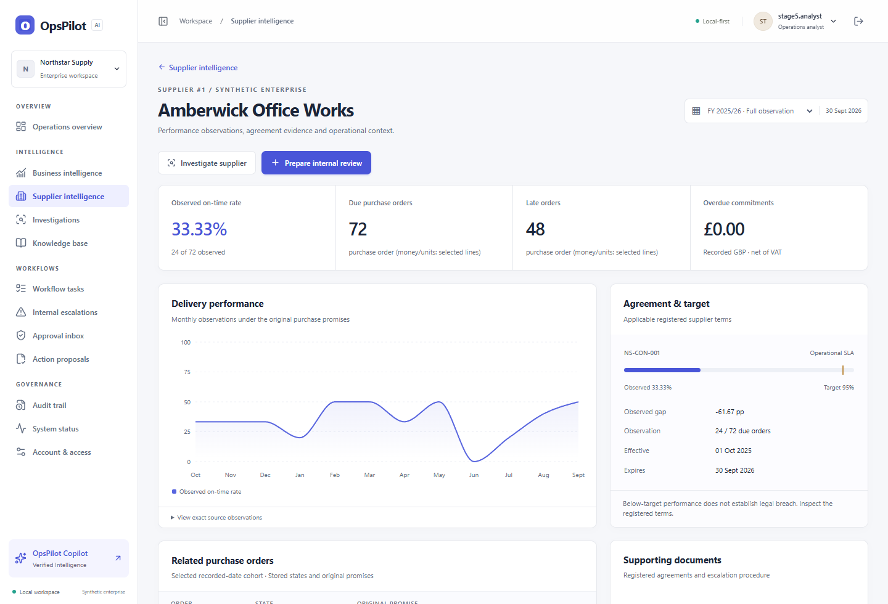
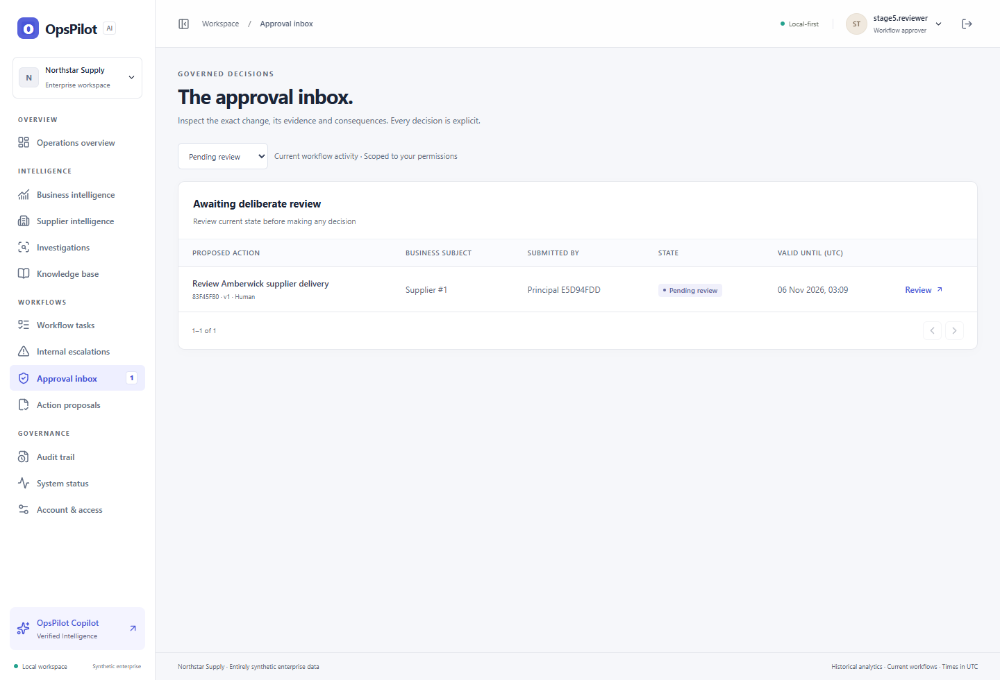

# OpsPilot screenshot gallery

Captured in Microsoft Edge from the release application running against the separate synthetic Northstar Supply database. Primary frames use a 1440 × 980 desktop viewport. The historical date selection is visible where relevant. Workflow entries come from the real operator, reviewer and executor sequence. [How to reproduce the demo](../../docs/DEMO_GUIDE.md)

| View | Route and scope |
|---|---|
| [01. Operations dashboard](01_dashboard.png) | `/` · Full historical observation window and real database KPIs |
| [02. Supplier intelligence](02_supplier_intelligence.png) | `/suppliers/1` · Amberwick Office Works, delivery history and applicable target |
| [03. Procurement analytics](03_procurement_analytics.png) | `/analytics/procurement` · August order cohort and commitments |
| [04. Inventory and warehouses](04_inventory_warehouses.png) | `/analytics/inventory` · Product 44 and warehouse 3 |
| [05. Financial intelligence](05_financial_intelligence.png) | `/analytics/finance` · Recorded August GBP balances and supplier segments |
| [06. Knowledge Base](06_knowledge_base.png) | `/knowledge` · Keyword result for the registered procurement procedure |
| [07. Business investigation](07_business_investigation.png) | `/investigations` · Supplier 1, SLA comparison and registered policy evidence |
| [08. OpsPilot Copilot](08_ops_pilot_copilot.png) | `/copilot` · Deterministic follow-up comparing two ranked suppliers |
| [09. Workflow tasks](09_workflow_tasks.png) | `/tasks` · Current, persisted demo review task |
| [10. Approval inbox](10_approval_inbox.png) | `/approvals` · Separate reviewer viewing the submitted proposal |
| [11. Execution receipt](11_workflow_execution_receipt.png) | `/proposals/<id>#receipt` · Actual committed receipt and linked task |
| [12. Audit trail](12_audit_trail.png) | `/audit` · Real events scoped to the task’s proposal |

