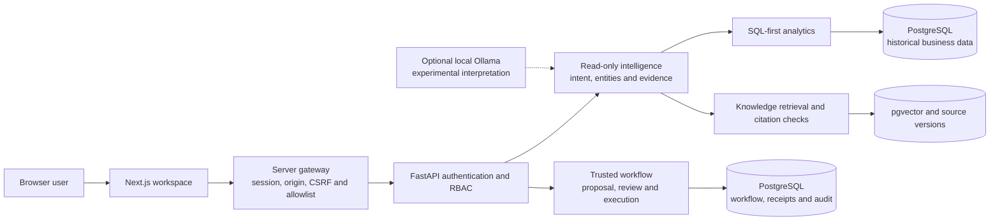
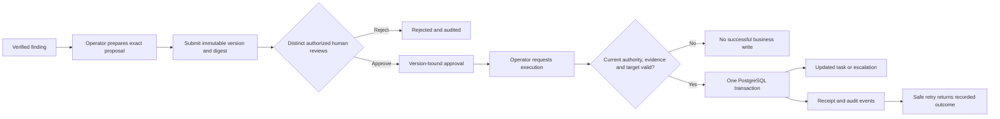

# OpsPilot architecture

OpsPilot is a modular application. Next.js owns the browser experience and its protected session. FastAPI owns business definitions, source verification and authorization. PostgreSQL is the authoritative source for the synthetic business and governed changes.

The stores in the diagram are logical populations in the same PostgreSQL database. Workspace browser reads and writes go through the gateway. Historical FastAPI read endpoints retain a separate loopback developer surface. Models receive no workflow credentials or decision authority.

1. The reporting window and recognized entities constrain the question. The deterministic interpreter selects registered capabilities and produces a bounded plan.
2. Allowlisted tools query the analytical service and, when relevant, retrieve registered knowledge passages. SQL metrics retain units, population and scope. Citation resolution verifies the source document version and checksum.
3. The evidence graph records facts and relationships. Composition keeps reported cost separate from inferred loss, and operational comparisons separate from legal conclusions.
4. An operator can turn a finding into an internal proposal. That starts the write path below.

Proposal and policy locks, database constraints and the durable operation key coordinate races. Receipt and audit writes participate in transaction checks. A failed or expired approval cannot be repaired by client state, changing the payload or text from a model. [Workflow reliability](RELIABILITY_EVALUATION.md)

Alembic owns schema versioning. Migration 0003 introduces the derived knowledge index and 0004 adds workflow, authorization and audit. The deterministic generator seeds the source population into an empty database and validates the source checksums. Later workflow operations occupy separate tables and do not alter the accepted historical fingerprint. [Data and checks](STAGE8_REPORT.md) · [Gateway internals](FRONTEND_API_INTEGRATION.md)
