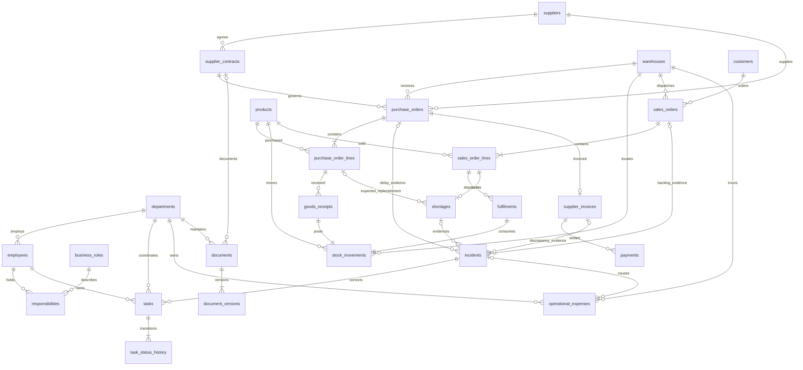

# Relational data model

All 26 tables have assigned integer primary keys, `created_at TIMESTAMPTZ`, and
`synthetic BOOLEAN`. Operational event dates use PostgreSQL DATE. Financial
amounts use NUMERIC(12,2) or NUMERIC(14,2); service targets use NUMERIC(5,2).
Stock quantities are integers. Foreign keys use restrictive default deletion;
important references/statuses/promises have lookup indexes.

`seed_runs` records seed/version/fingerprint provenance. ER cardinalities describe
the seeded business; optional incident FKs allow typed cross-domain evidence and
avoid unvalidated polymorphic `entity_type/entity_id` references.

| Domain | Tables and key facts |
|---|---|
| Organisation | departments; employees with department and unique `.example` business email; business_roles; unique employee/role responsibilities |
| Procurement | suppliers; supplier_contracts with reference, dates, target and escalation/payment days; purchase_orders with supplier, contract, warehouse and original promise; unique product per purchase_order_lines |
| Inventory | products with unique SKU; warehouses; goods_receipts against purchase lines; stock_movements with unique receipt/fulfilment source; shortages against a unique sales line with optional expected purchase line |
| Sales | customers; sales_orders with warehouse/customer and original dispatch promise; sales_order_lines; partial fulfilments and delivery indicator |
| Finance | unique invoice per purchase order; partial payments; operational_expenses with category, exact amount, explicit basis and optional incident/order evidence |
| Operations | incidents with constrained type/severity/status and required typed evidence; owned tasks with dates/priorities; task_status_history |
| Knowledge | documents with department and optional supplier contract; unique document/version document_versions with effective date, local path and SHA-256 |
| Provenance | seed_runs with seed, generator version and logical fingerprint |

Row constraints reject invalid statuses, nonpositive commercial quantities/prices,
invalid date ordering, inconsistent completion/closure flags and non-GBP currency.
The stock-source check allows one positive receipt, one negative issue, or a
documented signed adjustment. No transfer generator or reservation system exists.

PostgreSQL triggers lock affected order lines/invoices before checking aggregate
over-receipts, over-fulfilment and overpayment. Source-matching ledger inserts use
product/warehouse transaction advisory locks, verify event quantity/date/location,
and reject any negative cumulative stock prefix. The compound index
`(product_id, warehouse_id, occurred_on, id)` supports these checks. Deferred
constraint triggers require exactly one ledger movement for every receipt/dispatch
at commit. Event UPDATE/DELETE is rejected; corrections must use explicit events.

Cross-row contract ownership, order status, invoice reconciliation, shortage
resolution, task histories and corpus consistency are also checked by the full
seed validator and PostgreSQL-loaded validation script. There are no write API
paths; future mutation services must enforce these domain contracts as well.

Derived facts are not duplicated: order line values, ordered/received/outstanding
totals, stock balances, overdue flags, invoice balances and supplier performance
are queried from authoritative events. Header statuses and shortage missing-unit
snapshots are deliberately stored operational state, validated against their events.
