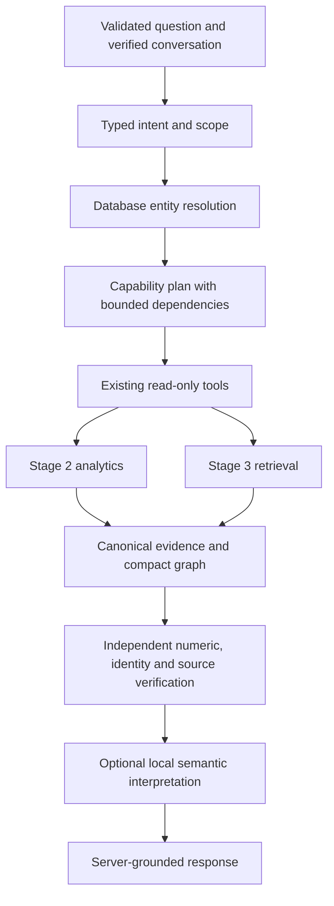

# Hybrid enterprise intelligence

Stage 4C adds `/api/v1/hybrid/query`; the existing analytics, knowledge and experimental
`/api/v1/agent/query` APIs remain compatible. `HYBRID_LOCAL` is the intended primary
mode. Local model quality is a separate acceptance gate; a successful deterministic
answer does not establish that gate.

The Stage 4B audit found repeated tool schemas, growing transcripts, model-selected
mandatory sources and model-written numerical prose at the centre of repeated
failures. The hybrid path moves these responsibilities to small Python components.
It reuses `ToolExecutor`, argument validation, reader transactions, Stage 2 services,
Stage 3 retrieval/citations, and `verify_final`. It introduces no business SQL engine,
migration, vector index, graph database, broker or external inference dependency.

`app/hybrid/contracts.py` defines requests, mentions, objectives, subjects, plans,
steps/bindings, facts, graph and execution metadata. `registry`, `intent`, `resolution`,
`planning`, `engine`, `evidence`, `language`, `resources` and `composition` implement
those boundaries. Steps execute sequentially under the existing twelve-tool and
ninety-second ceilings. A model cannot authorize or execute a tool.

Modes:

- `DETERMINISTIC`: no model; supported grammar/structured objectives, real analytics,
  retrieval, evidence verification and clearly labelled server-rendered responses.
- `HYBRID_LOCAL`: same mandatory plan and verification; ambiguous language may use
  a compact local intent frame. Documents/relationships may use a local relevance
  and qualification frame. Invalid/unavailable inference falls back transparently.
- `LOCAL_FULL_AGENT`: preserved experimental agent, disabled at this gateway unless
  `HYBRID_ALLOW_LEGACY=true`, the configured provider is Ollama, and host admission
  confirms its exact model/context. The original legacy endpoint remains available
  for the existing research workflow; it is not an automatic fallback.

The language frame selects existing capability/fact identifiers and supported
qualifications. It does not generate unrestricted business prose. The composer
renders verified facts and full selected source passages. This is deliberately
narrow language assistance, not a claim of general autonomous reasoning.

See [acceptance report](STAGE4C_REPORT.md), [planning](INTENT_AND_PLANNING.md),
[grounding](EVIDENCE_AND_GROUNDING.md) and [Windows runtime](LOCAL_HYBRID_PERFORMANCE.md).
