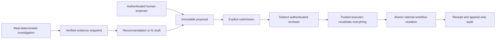

# Stage 5 workflow architecture

The accepted Stage 4C engine remains a read-only analytics and retrieval system. Stage 5 adds a separate, authenticated operational write boundary. It never extends the 17 agent tools with a write tool and never changes original seeded tasks or Stage 2 KPI inputs. No model is required or invoked by the workflow pipeline.

A recommendation returns an unpersisted typed proposal input. A human must explicitly create and submit it. Approval binds one immutable version and SHA-256 digest; execution is a separate authorized request. Text in evidence, notes, model output or a claimed approver field has no authorization effect.

The new Core metadata is independent of the original ORM Base and the knowledge metadata. Migration 0004 adds 18 tables: five authentication tables and thirteen workflow tables. Typed subjects have real nullable foreign keys for supplier, purchase order, sales order, warehouse, product, incident or department, exactly one populated with a matching kind. Tasks and escalations retain subject, source, proposal and execution provenance. No polymorphic free-text object ID substitutes for referential integrity.

Runtime traffic uses a distinct non-owner PostgreSQL login. Fixed NOLOGIN groups separate authentication, reads, review, execution and administration. All transactions SET LOCAL ROLE; membership is NOINHERIT. Migration/bootstrap uses the maintenance owner only. No SECURITY DEFINER function or model-controlled SQL is introduced.

The current application policy is local demonstration governance, not Northstar contract law: every allowlisted action requires one distinct active human approver. Original business APIs retain their earlier local read-only access contract; Stage 5 RBAC scopes the new workflow APIs, not every historical analytics endpoint. See STAGE5_SECURITY.md for deployment limits.

The workflow summary counts only new operational records. It does not merge seeded tasks with workflow tasks or alter historical metrics. A completed workflow task means the internal review was recorded; it does not prove supplier remediation or legal compliance.
